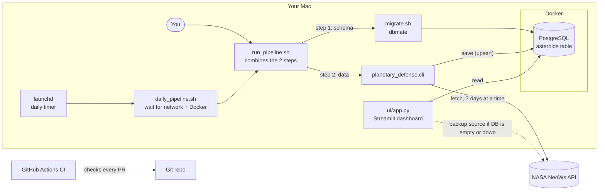
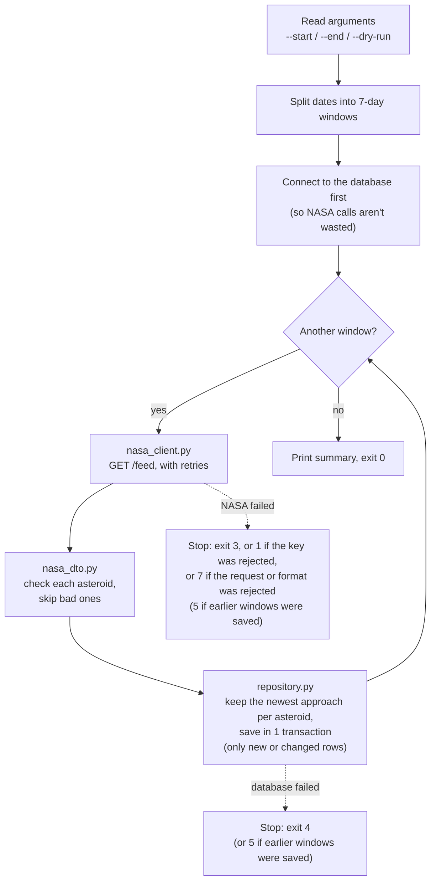
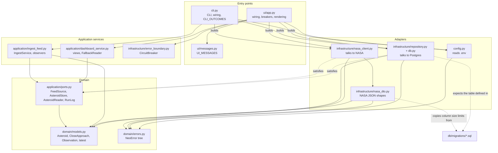
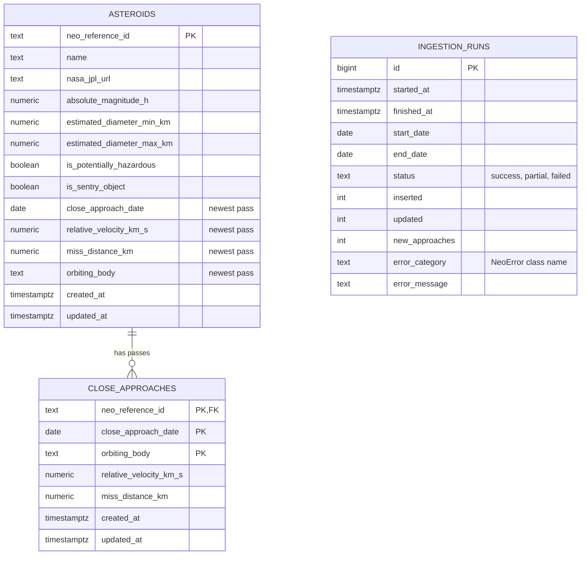

# Architecture

High-level diagrams of how the NASA NeoWs pipeline fits together. They render on GitHub, and in the VS Code Markdown preview with a Mermaid extension.

- [1. The big picture](#1-the-big-picture)
- [2. What one pipeline run does](#2-what-one-pipeline-run-does)
- [3. Which file depends on which](#3-which-file-depends-on-which)
- [4. How migrations reach the database](#4-how-migrations-reach-the-database)
- [5. How the data is stored](#5-how-the-data-is-stored)

---

## 1. The big picture

Who runs what, and where the data goes.

| Piece | Job |
|---|---|
| `scripts/daily_pipeline.sh` | Started by launchd. Waits for the network and Docker, then calls `run_pipeline.sh` |
| `scripts/run_pipeline.sh` | The only place that combines the schema step and the data step |
| `scripts/migrate.sh` | Schema step: applies or checks migrations with dbmate |
| `planetary_defense.cli` | Data step: fetch from NASA, check, save to Postgres |
| `planetary_defense.ui.app` | Dashboard that reads the saved data (`streamlit run app.py`) |

---

## 2. What one pipeline run does

Each window is saved in its own transaction, so a run that stops halfway keeps the finished windows. Re-running the same dates is always safe.

| Exit code | Meaning |
|---|---|
| 0 | Success |
| 1 | Configuration error (missing `.env` settings, or NASA rejected the API key) |
| 2 | Invalid arguments |
| 3 | NASA API unavailable or rate limited |
| 4 | Database error |
| 5 | Partial run: re-run the same dates to finish |
| 6 | Schema step failed, or migrations are pending (`run_pipeline.sh` / `migrate.sh` only) |
| 7 | NASA rejected the request, or its response format changed |
| 130 | Interrupted (Ctrl+C) |

---

## 3. Which file depends on which

Solid arrows are Python imports. Services and ports import only the domain; the entry points are the only modules that pick concrete adapters. Dotted arrows to `application/ports.py` mean "has the methods the protocol asks for"; nothing inherits, and pyright checks it in CI. Dotted arrows to migrations are assumptions kept in sync by hand. Tests fail if the column size limits in `nasa_dto.py` or the column list in `repository.py` drift from the migrations.

Errors: each adapter turns its library's exceptions into one `NeoError` subclass (`UpstreamUnavailable`, `UpstreamRateLimited`, `UpstreamAuthError`, `UpstreamRequestError`, `FeedContractError`, `StorageError`, `ConfigError`). The classes only classify. `cli.CLI_OUTCOMES` maps them to exit codes and `ui.messages.UI_MESSAGES` to dashboard text, both by the most specific class, so a new subclass can never crash a handler.

---

## 4. How migrations reach the database

dbmate applies only files not yet recorded in `schema_migrations`, oldest timestamp first. Strict mode rejects a file older than one already applied.

---

## 5. How the data is stored

Three tables. `asteroids` is the **current state**: one row per asteroid with its newest close approach, which is what the dashboard lists. `close_approaches` is the **history**: every pass the pipeline has seen. `ingestion_runs` records **what each pipeline run did**, which the dashboard shows as "last run".

How one window is written (all in one transaction, `AsteroidRepository.save`):

1. `domain.models.latest()` picks the newest observation per asteroid, which is upserted into `asteroids`. The SQL `WHERE` guard also refuses to replace a newer approach, so an old backfill or an overlapping run can't move it backwards.
2. Every observation's approach is upserted into `close_approaches`, keyed by `(neo_reference_id, close_approach_date, orbiting_body)`. A new pass adds a row; a pass NASA revised updates its numbers; a re-run changes nothing.

The `close_approaches` migration seeded the table from the approaches already in `asteroids`, so history starts with what was stored before it existed.

`ingestion_runs` gets one row per run that started fetching, written by `application.ingest_feed.IngestionRunRecorder` over its own autocommit connection, so a failed or partial run is recorded even after its data transaction rolled back. Runs that stop earlier (missing settings, database down) can't be recorded; the dashboard flags data older than 36 hours instead. Dry runs record nothing.
