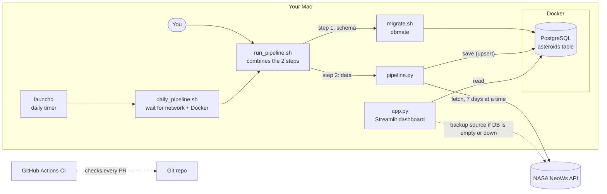
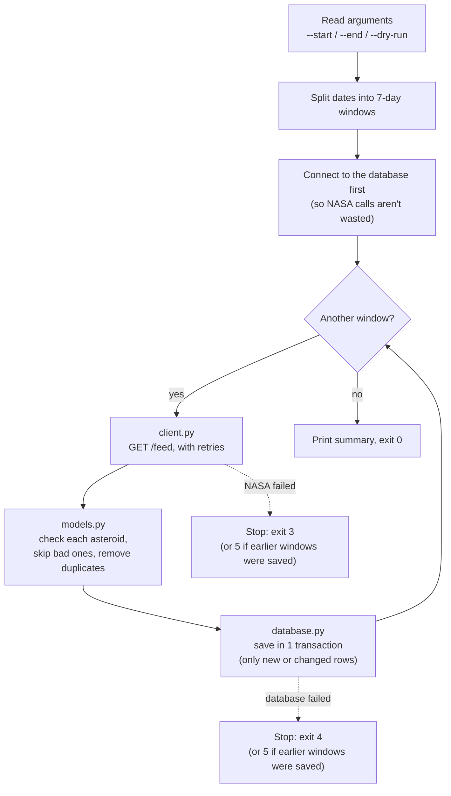
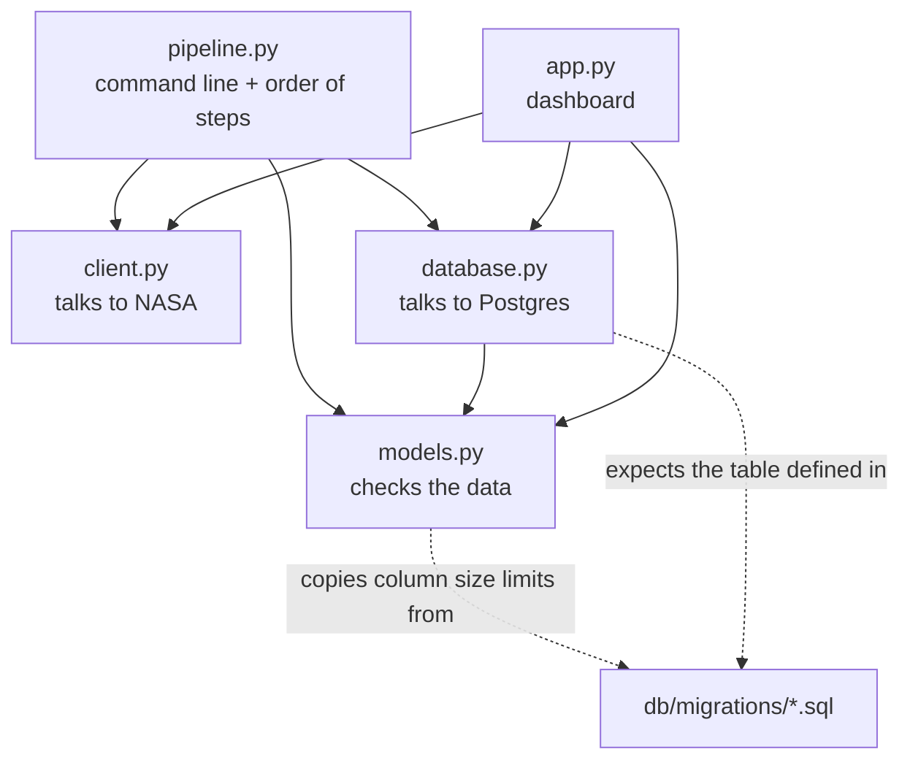
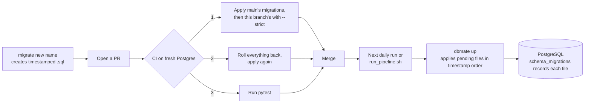
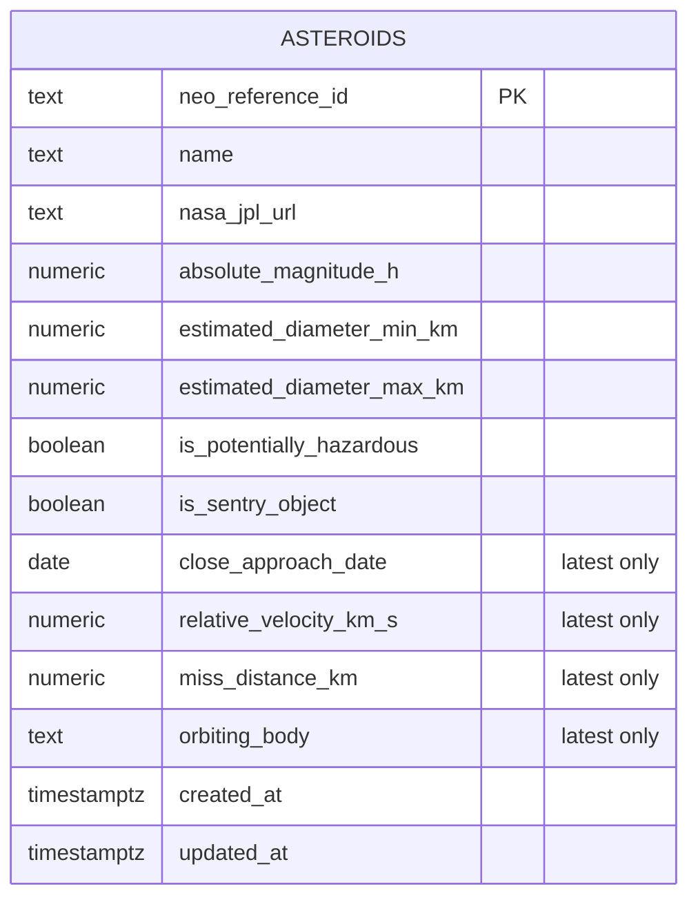
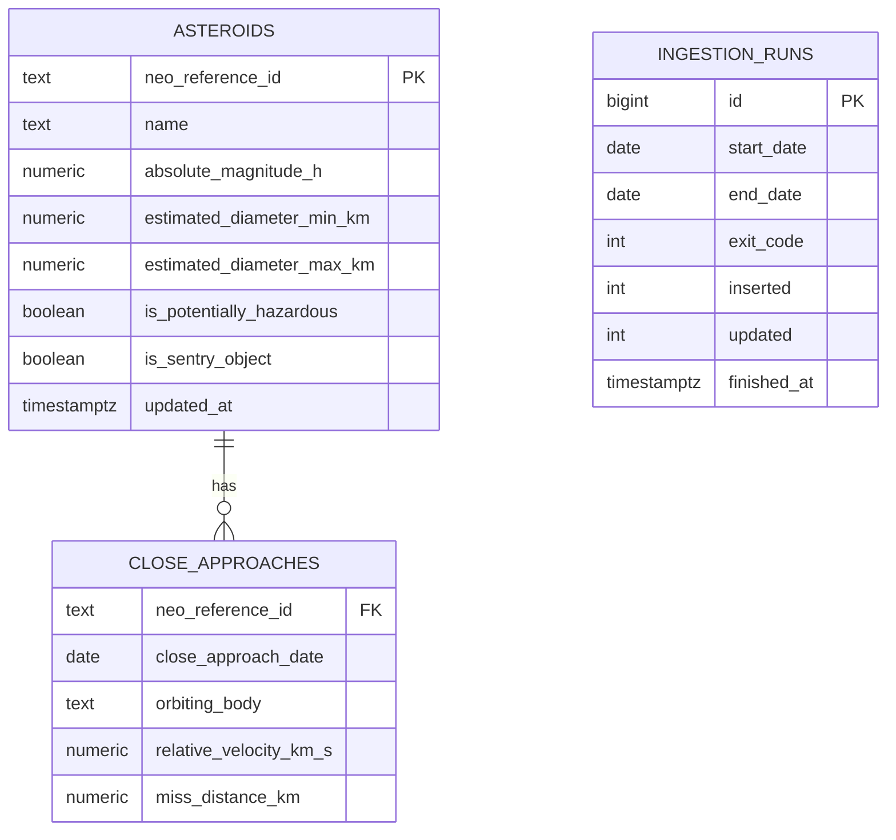

# Architecture

High-level diagrams of how the NASA NeoWs pipeline fits together. They render on GitHub, and in the VS Code Markdown preview with a Mermaid extension.

- [1. The big picture](#1-the-big-picture)
- [2. What one pipeline run does](#2-what-one-pipeline-run-does)
- [3. Which file depends on which](#3-which-file-depends-on-which)
- [4. How migrations reach the database](#4-how-migrations-reach-the-database)
- [5. How the data is stored](#5-how-the-data-is-stored)

---

## 1. The big picture

Who runs what, and where the data goes.

| Piece | Job |
|---|---|
| `scripts/daily_pipeline.sh` | Started by launchd. Waits for the network and Docker, then calls `run_pipeline.sh` |
| `scripts/run_pipeline.sh` | The only place that combines the schema step and the data step |
| `scripts/migrate.sh` | Schema step: applies or checks migrations with dbmate |
| `pipeline.py` | Data step: fetch from NASA, check, save to Postgres |
| `app.py` | Dashboard that reads the saved data |

---

## 2. What one pipeline run does

Each window is saved in its own transaction, so a run that stops halfway keeps the finished windows. Re-running the same dates is always safe.

| Exit code | Meaning |
|---|---|
| 0 | Success |
| 1 | Configuration error (for example, missing `.env` settings) |
| 2 | Invalid arguments |
| 3 | NASA API unavailable or returned unusable data |
| 4 | Database error |
| 5 | Partial run: re-run the same dates to finish |
| 6 | Schema step failed, or migrations are pending (`run_pipeline.sh` / `migrate.sh` only) |
| 130 | Interrupted (Ctrl+C) |

---

## 3. Which file depends on which

Solid arrows are Python imports. Dotted arrows are assumptions kept in sync by hand. A test fails if the column size limits in `models.py` drift from the migrations.

---

## 4. How migrations reach the database

dbmate applies only files not yet recorded in `schema_migrations`, oldest timestamp first. Strict mode rejects a file older than one already applied.

---

## 5. How the data is stored

### Current

One row per asteroid. Only the **latest** close approach is kept; earlier approaches are overwritten.

### Proposed

Facts about the asteroid live in one table and every close approach is kept in another, so history is preserved. `INGESTION_RUNS` records the result of each pipeline run.

`CLOSE_APPROACHES` would be unique on `(neo_reference_id, close_approach_date, orbiting_body)`, so re-runs stay safe.
